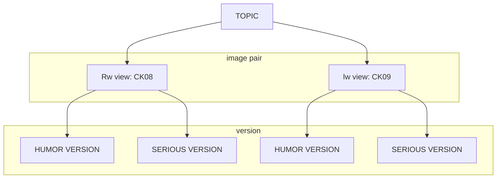

# README.md

Code Summary

## Overview

This repository contains R code for processing, validating, and analyzing data from a survey study that is piloting different stimuli for a future study on political humor. The study involves participants rating pairs of stimuli (memes and serious vignettes) on dimensions including funniness, polemicality (controversy), and similarity of message content.
 
**this is an ongoing work, so not everything is in its optimal form, nor are all the analysis already done**

Apart from this line and the previous one, this README was written using an AI assistant. Im sorry for this [heresy](https://www.youtube.com/watch?v=d8MByH0ELSo&list=RDd8MByH0ELSo&start_radio=1)
but i was kind of hungy and wanted to do a quick description of what to expect
I'll probably make a more human like version once I have the definited results

## Project Structure

The analysis is contained in a single R script  organized into the following major sections:

### 1. Data Preparation
Loads libraries (see dependencies). Imports Excel data, converts -9 to `NA`, filters participants over 36, defines metadata columns, and creates stimulus rating variable vectors (`ck_`, `pi_check`, `pi_ideology`). Adds `total_p` (pages viewed), `total_p_d` (dichotomous: ≤9 pages vs. more), and `avg_01`–`avg_05` (individual-level average ratings per dimension).

### 2. Data Restructuring
Selects gender, political ID, condition, page counts, and CK ratings into `base`. Pivots to long format with `id`, `ck_`, `question` (1–5), and `ck_value`. Converts gender and `total_p_d` to factors.

### 3. Missing Data Analysis
Runs Little's MCAR test per experimental condition (AS02), removing all-NA, metadata, and zero-variance columns. Cross-tabulates attrition by political affiliation and condition. Fits linear and logistic regressions testing whether perceived funniness predicts survey completion.
**this section is probably going to be deleted as the order of exposition of stimuli is random

### 4. Descriptive Statistics
Reports sample characteristics (political affiliation, gender, education, completion time). Compares average ratings across assignment groups. Generates density plots comparing memes vs. serious versions for funniness and polemicality. Produces consolidated descriptives table (`desc_ck`) with n, mean, SD, skew, kurtosis, and SE for all stimuli ratings.

### 5. Stimuli Selection Criteria
Defines a 5-step procedure: 
- (1) significant funniness differences between versions, 
- (2) funniness above/below version means, 
- (3) message similarity >4, 
- (4) correct political/ideological perception, 
- (5) comparable polemicality within pairs near the mean.

### 5. Step 0 – Fixed and Random Effects on Funniness
Fits nested `lmer` models (`m0`–`m3`) predicting funniness from version. Compares via `anova(refit=F)` and `ranova`. Selects `m2` (random slopes for version by participant, random intercepts for stimulus pair). Interprets BLUPs and variance components.

## Test to Select Images
### Step 1 – Pairwise Funniness Differences
Sets sum contrasts on `ck_`. Fits `f_pares2` (interaction `ck_ * version`, random slopes by participant). Uses `emmeans` with `revpairwise` contrast and FDR adjustment to test meme vs. serious differences per pair. Reports significance and effect sizes.

### Step 2 – Comparison Against Version Means
Uses `emmeans` with `eff` contrast to compute each stimulus's deviation from its version's grand mean. Classifies stimuli as PASS, CHECK-H, CHECK-S, or FAIL based on point estimates and 95% CIs of deviations.

### Step 3 – Similarity of Message Content
Aggregates mean similarity per pair. Fits nested `lmer` models (`simil1`–`simil3`) partitioning variance between participants and pairs. Compares via `anova(refit=F)` and `ranova`. Concludes similarity is uniformly high; pair identity contributes negligible variance.

### Step 4 – Political Nature and Ideological Position
Describes `pi_check` (political perception) and `pi_ideology` (right/left/neither). Builds `orientacion_stimuli` with counts and percentages. Maps stimuli to intended categories, computes Wilson CIs for intended proportion, one-sided z-tests, and misclassification criteria (≤15% cross-categorization for left/right, ≤30% for neither).

### Step 5 – Level of Offensiveness
Fits `lmer` models (`c_pares1`, `c_pares2`) predicting polemicality from `ck_ * version`. Selects `c_pares1` (random intercepts by participant) via `anova(refit=F)`. Uses `emmeans` for pairwise H vs. S contrasts (none significant) and `joint_tests` for omnibus effects. Computes each pair's deviation from the grand mean polemicality.

## 12. Cynicism Scales
**Agree/Disagree (`cinis_ad`)**: Selects VD03_01–VD03_06, converts -1 to NA, removes incomplete cases, computes Spearman correlations, Cronbach's alpha, descriptives, and a CFA via `lavaan` (noting insufficient data). **Frequency (`cinis_fr`)**: Selects VD05_01–VD10_01, inverts VD09_01, computes correlations and alpha.

### 13. Pending Tasks
Consolidate descriptive outputs with human-readable stimulus labels. Export stimuli selection summary (included/excluded pairs). Add summary of eliminated pairs once sufficient data is available.
Create a statistical test for first part of Step 4

## Dependencies

The script requires the following R packages:

| Library | What it does |
|---|---|
| `readxl` | Reads Excel files into R (`read_excel`). |
| `psych` | Descriptive stats and psychometrics (`describe`, `skew`, `kurtosi`, `cor.plot`). |
| `tidyverse` | Meta-package for data manipulation and plotting (`pivot_longer`, `mutate`, `filter`, pipes). |
| `ggplot2` | Grammar-of-graphics plotting (`ggplot`, `geom_density`, `geom_bar`). |
| `dplyr` | Data manipulation verbs (`filter`, `select`, `mutate`, `summarise`, `group_by`). |
| `lme4` | Fits linear and generalized linear mixed-effects models (`lmer`, `glmer`). |
| `lmerTest` | Adds Satterthwaite/Kenward-Roger df and p-values to `lme4` models. |
| `emmeans` | Estimated marginal means and contrasts from fitted models. |
| `merTools` | Diagnostics and tools for mixed-effects models (e.g., BLUPs, simulation). |
| `ltm` | Latent trait and classical test theory models (`cronbach.alpha`). Attaches `MASS`. |
| `misty` | Miscellaneous stats utilities, including Little's MCAR test (`na.test`). |
| `stargazer` | Formats and exports regression/model tables (LaTeX, HTML, text). |
| `purrr` | Functional programming tools (`map`, `map_dfr`, `walk`). |
| `tibble` | Modern data frames (`tibble`, `as_tibble`, `rownames_to_column`). |

## Usage

1. Ensure all dependencies are installed.
2. Place the survey data file in an accessible location.
3. The script will produce descriptive statistics, mixed model results, and stimuli selection classifications.

## Notes

- The script uses `file.choose()` for data import, so the file path is not hard-coded.
- Missing values are coded as -9 in the raw data and converted to `NA`.
- The analysis accounts for the nested structure of the data (ratings within participants and within stimulus pairs) using mixed-effects models.
- The stimuli selection procedure is designed to be conservative, prioritizing stimuli that clearly meet criteria for funniness differentiation, message similarity, and political content.
- LTM attaches MASS after dplyr so i use dplyr::select when needed

Results and Description of Stimuli Selection

*The goal of this pilot study is to select the experimental stimuli for an experiment whose preregistation can be seen [here](https://osf.io/m5vh3/overview?view_only=9df22fee2aa94b5ea9bbceda845da342)

# Structure of Stimuli

Stimuli have a particular structure, as explained in this graph

- There are a total of 20 total **topics** being tested. 16 are political, and 4 non political
  - Each topic is composed of two **pairs of images** that represent opposing views regarding the topic
  - Each pair of images is composed of a humorous version (a meme) and a non humorous version (text). They can be seen in the folder "tested_stimuli""

## Codes of the stimuli
In the df there are seveal variables called CKnn_01/02/03/04/05
CK## is the code for the pair of images
- _01: perceived polemicality (I checked, this word exists in english) of the humorous version
- _02: perceived polemicality (I checked, this word exists in english) of the serious version 
- _03: perceived funniness (I checked, this word exists in english) of the humorous version 
- _04: perceived funniness (I checked, this word exists in english) of the humorous version 
- _05: perceived similarity (I checked, this word exists in english) of the humorous version 

**The corresponding topics and political view of each pair of images is as follows**

| Código [Code] | Tema [Topic] | Posición Política [Political View] |
| --- | --- | --- |
| CK08 | cae [higher education loan] | derecha [right] |
| CK09 | cae [higher education loan] | izquierda [left] |
| CK10 | control_identidad [identity check] | derecha [right] |
| CK11 | control_identidad [identity check] | izquierda [left] |
| CK12 | economia [economy] | derecha [right] |
| CK13 | economia [economy] | izquierda [left] |
| CK14 | internacional_1 [international_1] | derecha [right] |
| CK15 | internacional_1 [international_1] | izquierda [left] |
| CK16 | internacional_2 [international_2] | derecha [right] |
| CK17 | interncional_2 [international_2] | izquierda [left] |
| CK18 | jornada | derecha [right] |
| CK19 | jornada | izquierda [left] |
| CK20 | ministros [ministers] | derecha [right] |
| CK21 | ministros [ministers] | izquierda [left] |
| CK22 | prioridades [priorities] | derecha [right] |
| CK23 | prioridades [priorities] | izquierda [left] |
| CK24 | protesta [protest] | derecha [right] |
| CK25 | protesta [protest] | izquierda [left] |
| CK26 | recortes [cuts / budget cuts] | derecha [right] |
| CK27 | recortes [cuts / budget cuts] | izquierda [left] |
| CK28 | registro [registry / record] | derecha [right] |
| CK29 | registro [registry / record] | izquierda [left] |
| CK30 | seguridad [security] | derecha [right] |
| CK31 | seguridad [security] | izquierda [left] |
| CK32 | ambiente [environment] | derecha [right] |
| CK33 | ambiente [environment] | izquierda [left] |
| CK34 | empleo [employment / jobs] | derecha [right] |
| CK35 | empleo [employment / jobs] | izquierda [left] |
| CK36 | ia [ai / artificial intelligence] | derecha [right] |
| CK37 | ia [ai / artificial intelligence] | izquierda [left] |
| CK38 | valores [values] | derecha [right] |
| CK39 | valores [values] | izquierda [left] |
| CK40 | audio [audio] | contra [against / con] |
| CK41 | audio [audio] | pro [pro / in favor] |
| CK42 | concierto [concert] | contra [against / con] |
| CK43 | concierto [concert] | pro [pro / in favor] |
| CK44 | invierno [winter] | contra [against / con] |
| CK45 | invierno [winter] | pro [pro / in favor] |
| CK46 | gatos [cats] | contra [against / con] |
| CK47 | gatos [cats] | pro [pro / in favor] |

