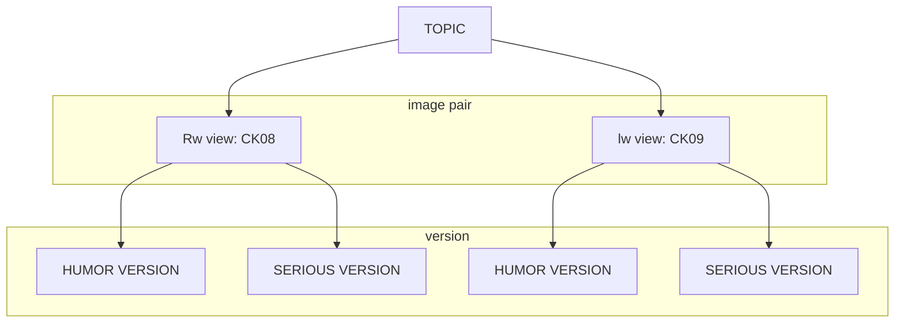

# README.md


<details>
<summary>Code Summary</summary>


# Pilot Analysis: Selection of Humorous/Serious Stimuli Pairs & Political Cynicism Scale

R script for the analysis of the pilot study used to (a) select image pairs (humorous meme version **H** vs. serious version **S**) for a later experiment, and (b) evaluate the psychometric properties of a political cynicism scale.

Each participant rated stimuli on five questions: polemicality of the meme (`_01`), polemicality of the serious version (`_02`), funniness of the meme (`_03`), funniness of the serious version (`_04`) and similarity of message between both versions (`_05`). Stimuli are identified as `CK08`–`CK47` (40 pairs: 16 right-wing, 16 left-wing and 8 non-political).

> Results are **not** reported here. They are documented in the section below.

## Table of Contents

1. [Data Preparation](#1-data-preparation)
2. [Data Formatting](#2-data-formatting)
3. [Descriptive: Sample](#3-descriptive-sample)
4. [Descriptive: Variables of Interest](#4-descriptive-variables-of-interest)
5. [Some Graphs](#5-some-graphs)
6. [Criteria for Selection of Stimuli](#6-criteria-for-selection-of-stimuli)
7. [Analysis of Political Cynicism Scales](#7-analysis-of-political-cynicism-scales)
8. [Dependencies](#dependencies)
9. [Usage](#usage)
10. [Notes](#notes)

---

## 1. Data Preparation

Loads the raw survey export (`pilot_analysis/pilot_data.xlsx`), recodes `-9` as `NA` and applies the exclusion filters:

- Participants above the accepted age (`SD04_01 <= 36`).
- Six test cases (`CASE` = 1661, 1668, 1671, 1672, 1673, 1677) that were coding tests of the panel redirection, not real participants.
- Speeders: `TIME_RSI >= 2` (Relative Speed Index, following Leiner, 2019).

### 1.1 Definitions of columns
Defines vectors of column names used throughout the script: metadata columns, the stimuli rating columns (`ck_`, `CK08_01`–`CK47_05`), the cynicism items (`VD03_01`–`VD03_06`), the "is it political?" checks (`PI01`–`PI40`), the ideology classification items (`PI41`–`PI80`), the intended ideological category of each image (`right_wing`, `left_wing`, `neither`) and the funniness columns of right-wing, left-wing and non-political memes (`f_rw_meme`, `f_lw_meme`, `f_np_meme`).

### 1.2 Creation of New Variables
- `total_p`: number of questionnaire pages seen by each participant (from the `TIME` columns), and `total_p_d`, a dichotomous version separating those who saw ≤ 9 pages (less than 50% of images) from the rest.
- `id_pol_3`: political orientation in three groups (1 = left, 2 = right, 3 = neither/center/don't know) recoded from `SD06`.
- `avg_01`–`avg_05`: per-participant average of each question across all 40 pairs.
- `mean_right`, `mean_left`, `mean_neither`: per-participant average funniness of right-wing, left-wing and non-political memes.

## 2. Data Formatting

Because ratings are nested within participants and image pairs, the data are reshaped to **long format** (`base`) to fit multilevel models. One row per participant × stimulus × question, with columns `id`, `ck_` (pair), `question` (1–5) and `ck_value` (the rating). Gender, `total_p_d` and `id_pol_3` are converted to factors.

## 3. Descriptive: Sample

Frequency tables and percentages for:
- Political orientation (`SD06` and `id_pol_3`), with a bar plot of the 1–9 left-right scale.
- Gender (`SD01`).
- Education (`SD07`).
- Average completion time (`TIME_SUM`).

## 4. Descriptive: Variables of Interest

Mean, median, SD, skewness, kurtosis and N of the five averaged ratings (`avg_01`–`avg_05`) by image set assignment group (`AS02`). Because both the assignment of image sets and of conditions was random, differences between groups are expected to be due to chance only. This step also includes:
- Overall funniness of memes by political orientation (bar plot).
- Correlations among the five overall ratings.

## 5. Some Graphs

Exploratory visualizations built from the long dataset:
- **5.1** Funniness of meme vs. serious versions: % of responses by value.
- **5.2** Polemicality of meme vs. serious versions: % of responses by value.
- **5.3** Perceived funniness of left-wing, right-wing and non-political memes by participants' political orientation (means with 95% CI).
- **5.4** Density plots of funniness of left-wing, right-wing and non-political memes by political orientation.
- **5.5** Perceived polemicality of left-wing, right-wing and non-political memes by participants' political orientation (means with 95% CI).

## 6. Criteria for Selection of Stimuli

Pairs are filtered through a sequence of criteria ordered from the most to the least strict in terms of flexibility. If one image of a pair fails, the whole pair (and its topic cluster) is discarded:

1. Significant funniness difference between H and S version.
2. H funniness ≥ average of all H versions, and S funniness ≤ average of all S versions.
3. Both versions are perceived as expressing a similar message (rating ≥ 4).
4. Images are perceived as intended: political/non-political, and right/left/neither.
5. Polemicality: no differences within pair, and pairs near the average level.

### 6.x Step 0: Modelling of Fixed and Random Effects
Builds `fun_df` (long format, with `version` as factor and **S as baseline**) and compares random-effects structures with `lmer` (REML): intercepts by participant only (`m0`), plus intercepts by pair (`m1`), plus random slope of version by participant (`m2`). Models are compared with `anova(..., refit = FALSE)`, and inference uses Kenward-Roger degrees of freedom. Random effects (BLUPs) are inspected with `ranef()` and `ranova()`.

### 6.1 Step 1: Funniness Differences within Image Pair
Pair (`ck_`) is now entered as a **fixed** factor with sum-to-zero contrasts (deviations from the grand mean), interacting with `version`. Three random structures are compared (`f_pares1`–`f_pares3`) and the best one is used with `emmeans` to obtain the H − S contrast within each pair. P-values are adjusted with Benjamini-Hochberg (FDR) given the 40 comparisons.

### 6.2 Step 2: H/S Comparison across Mean
Descriptive validation step. Using effect contrasts (`"eff"`) on the estimated marginal means, each pair's H and S versions are compared to the average of all H and all S versions (unadjusted CIs). Each version is tagged as "clearly above", "clearly below" or "ambiguous", and a selection label is assigned (`PASS`, `CHECK-H`, `CHECK-S`, `FAIL`).

### 6.3 Step 3: Similarity of Message Content
Computes the mean similarity rating (`question == 5`) by pair, the range and SD of those means, and fits intercept-only mixed models (participant, and participant + pair) to assess how much variance is due to participants vs. images. An exploratory model tests whether political orientation (`id_pol_3`, sum-coded) predicts perceived similarity, with Tukey-adjusted pairwise comparisons.

### 6.4 Step 4: Image Classification
- **6.4.1** Checks whether political memes are perceived as political and non-political memes as non-political (`PI01`–`PI40`).
- **6.4.2** Checks whether memes are classified in the ideological category they were designed for (`PI41`–`PI80`). Computes counts and proportions per category, Wilson 95% CIs (`wilson_ci()`), and a one-sided z-test (H0: p ≤ .50).
  - *Strict criteria:* CI lower bound of intended category > 50% and cross-classification ≤ 15% (≤ 30% combined for non-political).
  - *Relaxed criteria:* more than 60% of participants classify the image as intended.

### 6.5 Step 5: Level of Polemicality
Repeats the Step 1 approach with polemicality ratings (`polemic_df`): compares three random structures (`c_pares1`–`c_pares3`), tests H − S differences within each pair (FDR) and compares each pair's mean polemicality to the unweighted mean of all pairs using effect contrasts. A second version with half-coded `version` (±0.5) is fitted to compare against the grand mean rather than against S as baseline.

### 6.6 ... and the winners are!!!!
Comments listing the final pairs selected after applying the relaxed criteria of Step 4 (right-/left-wing pairs by topic group) together with the non-political pairs.

## 7. Analysis of Political Cynicism Scales

Evaluation of a 6-item political cynicism scale (based on Patty et al., 2012) in two wordings: agreement/disagreement (`VD03_01`–`VD03_06`) and frequency (`VD05`–`VD10`, from Lothamer, 2025).

### 7.1 Agree/Disagree Scale: Cronbach
Isolates the participants assigned to this version, recodes `-1` ("prefer not to answer") as `NA`, computes Spearman correlations and Cronbach's alpha with a bootstrapped CI (`ltm::cronbach.alpha`, B = 10000).

### 7.2 CFA
- One-factor CFA (`lavaan`, MLR estimator) and modification indices.
- Adjusted model with correlated residuals between items 1–4 and 5–6.
- Measurement invariance across political groups (`id_pol_3`): configural, metric (equal loadings) and scalar (equal loadings + intercepts), compared with `semTools::compareFit`.
- Mean cynicism by political group with 95% CIs (bar plot).

### 7.3 Frequency Scale
Descriptives, reverse coding of `VD09_01` (`6 - x`), Spearman correlations and Cronbach's alpha for the frequency wording of the scale.

---

## Dependencies

R packages used:

| Purpose | Packages |
|---|---|
| Data import & wrangling | `readxl`, `tidyverse`, `dplyr`, `purrr`, `tibble` |
| Plotting | `ggplot2` |
| Descriptives & reliability | `psych`, `ltm`, `misty` |
| Mixed models & post-hoc | `lme4`, `lmerTest`, `emmeans`, `merTools`, `pbkrtest` (used by `emmeans`/`lmerTest` for Kenward-Roger) |
| Tables | `stargazer` |
| SEM / CFA / invariance | `lavaan`, `semTools` |


## Usage

1. Place the raw data file in `pilot_analysis/pilot_data.xlsx` (the script uses relative paths, so open the project from the repository root).
2. Open the script in R/RStudio and run it **top to bottom** the first time, since later steps depend on objects created earlier (`bd`, `base`, `fun_df`, etc.).
3. Global options set at the top of the script:
   ```r
   options(scipen = 999)
   emm_options(lmerTest.limit = 15000, pbkrtest.limit = 15000)
   set.seed(2010)
   ```
4. Sections 3–5 are descriptive and can be skipped. Section 6 (stimuli selection) and Section 7 (cynicism scales) can be run separately as long as Sections 1–2 were run before.

## Notes

- **Order of filters:** if you want to filter out participants who saw fewer than 6 pages (`total_p >= 6`; people who never saw an image), do it **after** the cynicism analysis (Section 7). Some people abandoned the survey before seeing images but did answer the cynicism scale, and keeping them gives more data for the CFA. That line is therefore commented out.
- **Package loading order:** `ltm` attaches `MASS` after `dplyr`, so `dplyr::select()` is used explicitly where needed. `ltm` sometimes doesn't load properly, so load it before running `cronbach.alpha`.
- **Kenward-Roger degrees of freedom:** `emm_options(lmerTest.limit = 15000, pbkrtest.limit = 15000)` is needed so that `emmeans` computes t-based confidence intervals even when the number of observations exceeds the default limit. Without it, `lower.CL` and `upper.CL` are not computed (relevant for Step 2).
- **Political orientation grouping:** `id_pol_3` groups centrists/independents and non-political participants together (code 3). This is not ideal, but it is the best option given the available information.
- **Random-effects structure:** the maximal model (`version * ck_` with random slopes by participant and by participant × pair) did not converge, and some alternatives were singular. The random factor with the lowest variance (`ck_`) was dropped, following Singmann & Kellen (2020). REML is used because models with the same fixed effects are compared. Pair is later entered as a fixed factor only because within-pair comparisons require it.
- **Significance testing:** Kenward-Roger approximation is used for p-values, as recommended by Luke (2019).
- **Coding of contrasts:**
  - `version` is dummy-coded with S as baseline, because the interest is in simple effects within each pair (the model is deliberately not half-centered in Step 1).
  - `ck_` is sum-coded, so the `version` coefficient reflects the humor effect for an average pair, while `ck_` coefficients reflect deviations within the baseline version (S).
  - In Step 5 (polemicality vs. grand mean) half-coding (±0.5) is used instead.
- **Multiple comparisons:** within-pair H − S comparisons (40 tests) use Benjamini-Hochberg FDR as a less conservative correction. Deviations from the grand mean in Steps 2 and 5 are descriptive and left unadjusted; results in Step 5 change depending on whether `"none"` or `"fdr"` is used, so interpret with caution (winner's curse).
- **Pairs with ambiguous status:** since the sample is biased, a pair with a confidence interval including the mean ("ambiguous") is not discarded immediately; only pairs clearly failing the criteria are removed.
- **Stimulus classification (Step 4):** very few pairs pass the strict criteria (except the non-political ones), so the relaxed criteria are used. The wording of the item ("Images express a typical opinion from the following political sector") may have been wordy and confusing; high cross-classification may reflect participants interpreting it as "who is the meme talking about", and "neither" may indicate that criticism of one side isn't seen as exclusive to the opposite side. The cross-classification threshold (0.15) is sensitive: a slightly higher value (0.155) would keep some memes that are otherwise discarded.
- **Similarity and polemicality of serious versions:** do not over-interpret the correlation between funniness of serious images and other ratings; it is probably due to density at the lower end of the scale. The effect of political orientation on perceived similarity is exploratory, with no theoretical backing.
- **Cynicism scale:** the frequency version (Lothamer, 2025) was dropped after the first ~45–80 responses because of extremely poor reliability, and the remaining participants answered only the agree/disagree version. Items `VD09_01` is reverse-coded in the frequency version. Residual covariances between items 1–4 (manipulation by politicians) and 5–6 (immorality) are theoretically plausible, consistent with the evidence that political cynicism may have several first-order dimensions.
- **Invariance and group means:** scalar invariance across political groups is not supported, so group means of cynicism computed as unweighted item averages are biased and should be interpreted with care.
- **Cleanup:** `rm()` calls are used throughout to free memory.

## References

- [Leiner, D. J. (2019)](http://dx.doi.org/10.18148/srm/2019.v13i3.7403)
- [Luke, S. G. (2017)](https://doi.org/10.3758/s13428-016-0809-y)
- [Patty, et al. (2012)](https://journals.sagepub.com/doi/10.1002/per.858)
- [Lothamer (2025)](https://uh-ir.tdl.org/items/53028c50-16f3-41e0-8f06-0273b728a718) 
- [Singmann, H., & Kellen, D. (2020)](https://www.taylorfrancis.com/chapters/edit/10.4324/9780429318405-2/introduction-mixed-models-experimental-psychology-henrik-singmann-david-kellen)


</details>


<details>
<summary>Results and Description of Stimuli Selection</summary>

**The goal of this pilot study is to select the experimental stimuli for an experiment whose preregistation can be seen [here](https://osf.io/m5vh3/overview?view_only=9df22fee2aa94b5ea9bbceda845da342)**

# Structure of Stimuli

Stimuli have a particular structure, as explained in this graph



- There are a total of 20 total **topics** being tested. 16 are political, and 4 non political
  - Each topic is composed of two **pairs of images** that represent opposing views regarding the topic
  - Each pair of images is composed of a humorous version (a meme) and a non humorous version (text). They can be seen in the folder "tested_stimuli""

## Codes of the stimuli
In the df there are seveal variables called CKnn_01/02/03/04/05
CK## is the code for the pair of images
- _01: perceived polemicality (I checked, this word exists in english) of the humorous version
- _02: perceived polemicality (I checked, this word exists in english) of the serious version 
- _03: perceived funniness (I checked, this word exists in english) of the humorous version 
- _04: perceived funniness (I checked, this word exists in english) of the serious version 
- _05: perceived similarity (I checked, this word exists in english) between version of the same pair 

**The corresponding topics and political view of each pair of images is as follows**

| Código [Code] | Tema [Topic] | Posición Política [Political View] |
| --- | --- | --- |
| CK08 | cae [higher education loan] | derecha [right] |
| CK09 | cae [higher education loan] | izquierda [left] |
| CK10 | control_identidad [identity check] | derecha [right] |
| CK11 | control_identidad [identity check] | izquierda [left] |
| CK12 | economia [economy] | derecha [right] |
| CK13 | economia [economy] | izquierda [left] |
| CK14 | internacional_1 [international_1] | derecha [right] |
| CK15 | internacional_1 [international_1] | izquierda [left] |
| CK16 | internacional_2 [international_2] | derecha [right] |
| CK17 | interncional_2 [international_2] | izquierda [left] |
| CK18 | jornada | derecha [right] |
| CK19 | jornada | izquierda [left] |
| CK20 | ministros [ministers] | derecha [right] |
| CK21 | ministros [ministers] | izquierda [left] |
| CK22 | prioridades [priorities] | derecha [right] |
| CK23 | prioridades [priorities] | izquierda [left] |
| CK24 | protesta [protest] | derecha [right] |
| CK25 | protesta [protest] | izquierda [left] |
| CK26 | recortes [cuts / budget cuts] | derecha [right] |
| CK27 | recortes [cuts / budget cuts] | izquierda [left] |
| CK28 | registro [registry / record] | derecha [right] |
| CK29 | registro [registry / record] | izquierda [left] |
| CK30 | seguridad [security] | derecha [right] |
| CK31 | seguridad [security] | izquierda [left] |
| CK32 | ambiente [environment] | derecha [right] |
| CK33 | ambiente [environment] | izquierda [left] |
| CK34 | empleo [employment / jobs] | derecha [right] |
| CK35 | empleo [employment / jobs] | izquierda [left] |
| CK36 | ia [ai / artificial intelligence] | derecha [right] |
| CK37 | ia [ai / artificial intelligence] | izquierda [left] |
| CK38 | valores [values] | derecha [right] |
| CK39 | valores [values] | izquierda [left] |
| CK40 | audio [audio] | contra [against / con] |
| CK41 | audio [audio] | pro [pro / in favor] |
| CK42 | concierto [concert] | contra [against / con] |
| CK43 | concierto [concert] | pro [pro / in favor] |
| CK44 | invierno [winter] | contra [against / con] |
| CK45 | invierno [winter] | pro [pro / in favor] |
| CK46 | gatos [cats] | contra [against / con] |
| CK47 | gatos [cats] | pro [pro / in favor] |

## Selection of stimuli for project
As seen in the above graph, each topic is divided into two image pairs. Each one presenting opposing views (lw/rw in the case of political topics & pro/against in the case of non-political).

Given that the goal for the experiment is to have topics that have opposing messages. I'm looking for topics in which both pair of images pass the tests.

Therefore if just one of the image pairs fails some criteria, but it paired pair doesn't this topic is discarded for the final experiment. 

For example CK34 (rw) and CK35(lw) are the pair of images that form the topic "Work". CK35 fails two criteria and CK34 none. However CK35 "drags" CK34 as I can't use an image that is seen as funny while the other is not.


### Random Assignments to stimuli set

**Groups were assigned to 4 different groups**
Each groups viewed a different set of 10 pais of images(each topic includes two pais of images) as follow:

- **Grupo 1**
Tema 8 (internacional_2)  CK16-CK17
Tema 11 (jornada)  CK18-CK19
Tema 12 (recortes)  CK26-CK27
Tema 14 (empleo)  CK34-CK35
Tema audio  CK40-CK41


- **Grupo 2**
Tema 2 (seguridad) CK30-CK31
Tema 9 (economia)  CK12-CK13
Tema 13 (ambiente)  CK32-CK33
Tema 16 (valores) CK38-CK39
Tema concierto  CK42-CK43

- **Grupo 3**
Tema 4 (protesta) CK24-CK25
Tema 5 (prioridades)  CK22-CK23
Tema 6 (ministra)  CK20-CK21
Tema 7 (internacional_1)  CK14-CK15
Tema frio  CK44-CK45

- **Grupo 4**
Tema 1 (control)  CK10-CK11
Tema 3 (registro)  CK28-CK29
Tema 10 (cae) CK08-CK09
Tema 15 (ia&empleo)  CK36-CK37
Tema gato CK46-CK47


Topic were numbered 1 to 16, and then ran this code to randomize their grouping: 

```r
-----
Title: Randomization of topic grouping
-----

set.seed(6826)
sets <- split(sample(1:16, 16), 1:4)
print(sets)
```

The non political topic was assigned sequentially


</details>
