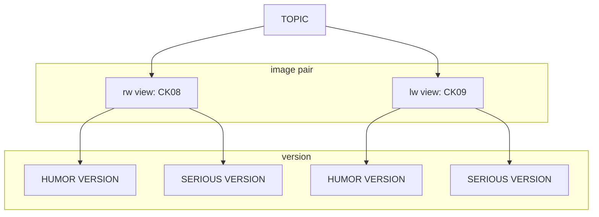
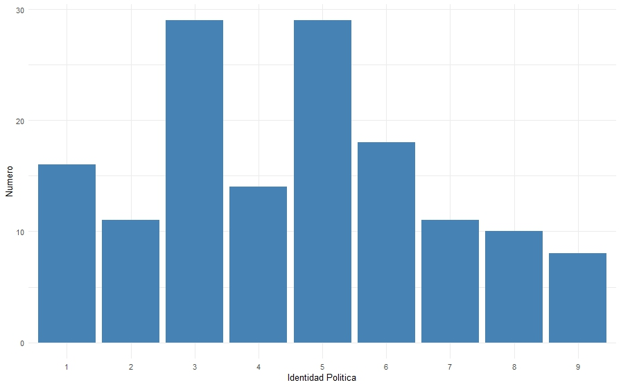
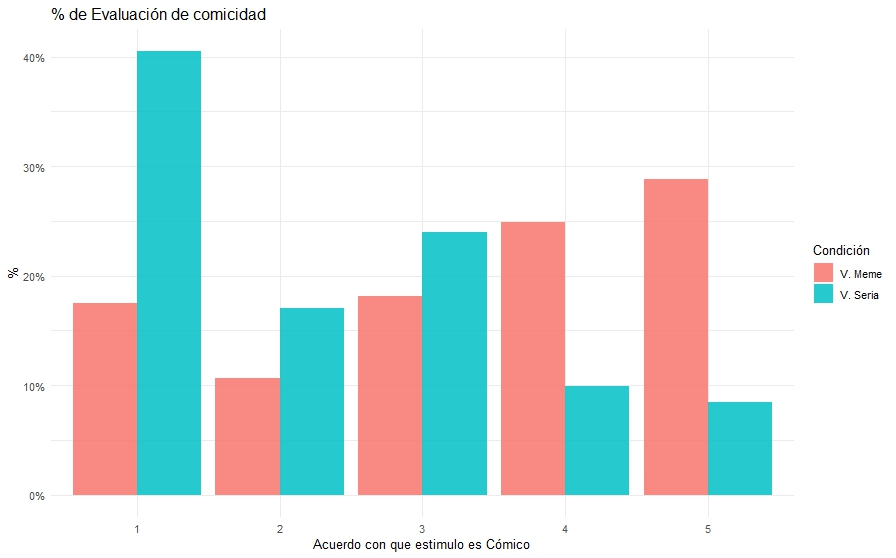
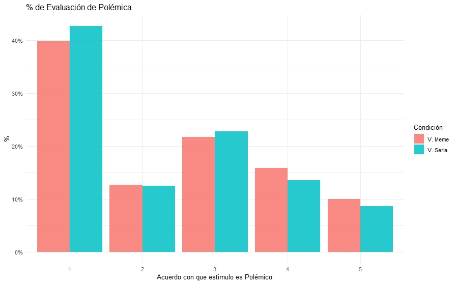
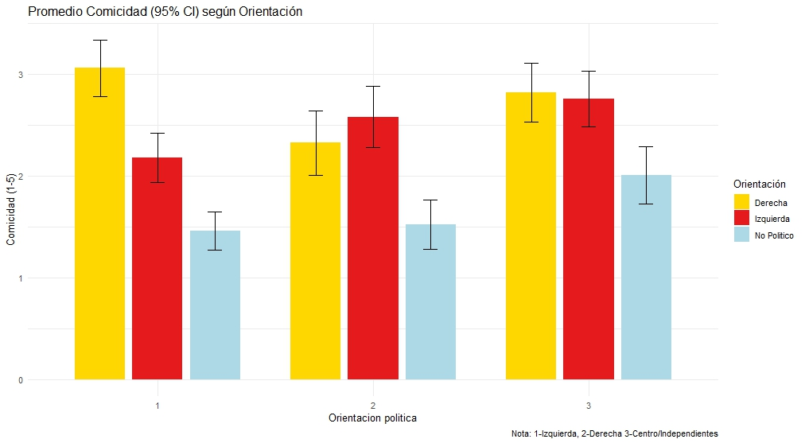
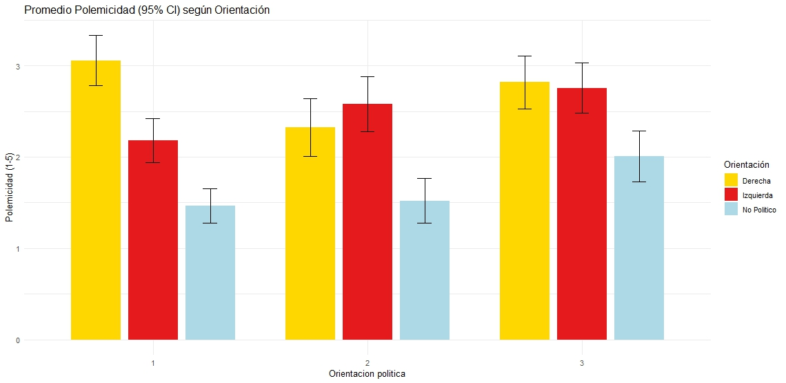
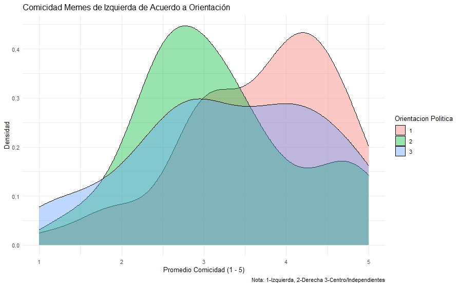
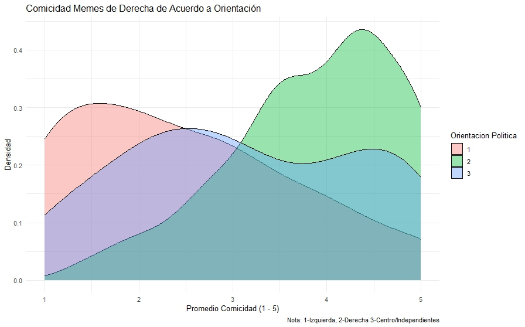
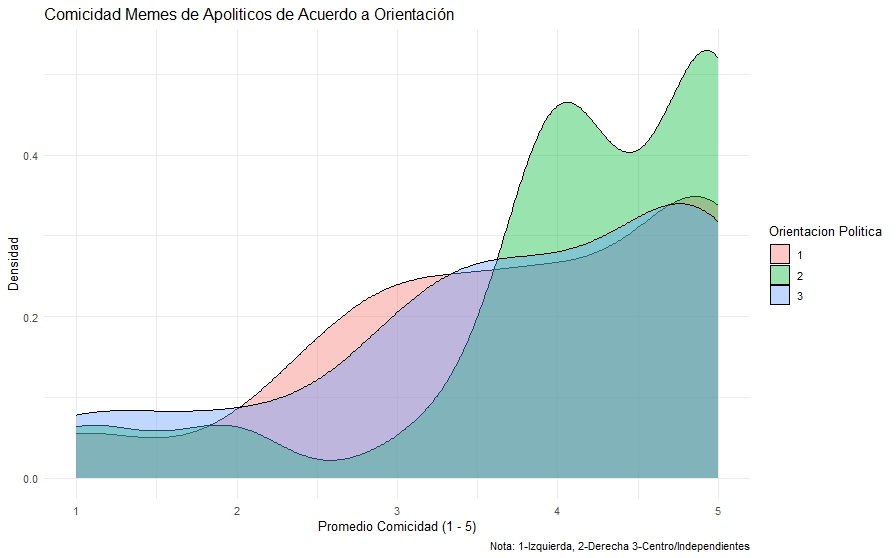

# README.md


<details>
<summary>Code Summary</summary>


# Pilot Analysis: Selection of Humorous/Serious Stimuli Pairs & Political Cynicism Scale

R script for the analysis of the pilot study used to (a) select image pairs (humorous meme version **H** vs. serious version **S**) for a later experiment, and (b) evaluate the psychometric properties of a political cynicism scale.

Each participant rated stimuli on five questions: polemicality of the meme (`_01`), polemicality of the serious version (`_02`), funniness of the meme (`_03`), funniness of the serious version (`_04`) and similarity of message between both versions (`_05`). Stimuli are identified as `CK08`–`CK47` (40 pairs: 16 right-wing, 16 left-wing and 8 non-political).

> Results are **not** reported here. They are documented in the section below.

## Table of Contents

1. [Data Preparation](#1-data-preparation)
2. [Data Formatting](#2-data-formatting)
3. [Descriptive: Sample](#3-descriptive-sample)
4. [Descriptive: Variables of Interest](#4-descriptive-variables-of-interest)
5. [Some Graphs](#5-some-graphs)
6. [Criteria for Selection of Stimuli](#6-criteria-for-selection-of-stimuli)
7. [Analysis of Political Cynicism Scales](#7-analysis-of-political-cynicism-scales)
8. [Dependencies](#dependencies)
9. [Usage](#usage)
10. [Notes](#notes)

---

## 1. Data Preparation

Loads the raw survey export (`pilot_analysis/pilot_data.xlsx`), recodes `-9` as `NA` and applies the exclusion filters:

- Participants above the accepted age (`SD04_01 <= 36`).
- Six test cases (`CASE` = 1661, 1668, 1671, 1672, 1673, 1677) that were coding tests of the panel redirection, not real participants.
- Speeders: `TIME_RSI >= 2` (Relative Speed Index, following Leiner, 2019).

### 1.1 Definitions of columns
Defines vectors of column names used throughout the script: metadata columns, the stimuli rating columns (`ck_`, `CK08_01`–`CK47_05`), the cynicism items (`VD03_01`–`VD03_06`), the "is it political?" checks (`PI01`–`PI40`), the ideology classification items (`PI41`–`PI80`), the intended ideological category of each image (`right_wing`, `left_wing`, `neither`) and the funniness columns of right-wing, left-wing and non-political memes (`f_rw_meme`, `f_lw_meme`, `f_np_meme`).

### 1.2 Creation of New Variables
- `total_p`: number of questionnaire pages seen by each participant (from the `TIME` columns), and `total_p_d`, a dichotomous version separating those who saw ≤ 9 pages (less than 50% of images) from the rest.
- `id_pol_3`: political orientation in three groups (1 = left, 2 = right, 3 = neither/center/don't know) recoded from `SD06`.
- `avg_01`–`avg_05`: per-participant average of each question across all 40 pairs.
- `mean_right`, `mean_left`, `mean_neither`: per-participant average funniness of right-wing, left-wing and non-political memes.

## 2. Data Formatting

Because ratings are nested within participants and image pairs, the data are reshaped to **long format** (`base`) to fit multilevel models. One row per participant × stimulus × question, with columns `id`, `ck_` (pair), `question` (1–5) and `ck_value` (the rating). Gender, `total_p_d` and `id_pol_3` are converted to factors.

## 3. Descriptive: Sample

Frequency tables and percentages for:
- Political orientation (`SD06` and `id_pol_3`), with a bar plot of the 1–9 left-right scale.
- Gender (`SD01`).
- Education (`SD07`).
- Average completion time (`TIME_SUM`).

## 4. Descriptive: Variables of Interest

Mean, median, SD, skewness, kurtosis and N of the five averaged ratings (`avg_01`–`avg_05`) by image set assignment group (`AS02`). Because both the assignment of image sets and of conditions was random, differences between groups are expected to be due to chance only. This step also includes:
- Overall funniness of memes by political orientation (bar plot).
- Correlations among the five overall ratings.

## 5. Some Graphs

Exploratory visualizations built from the long dataset:
- **5.1** Funniness of meme vs. serious versions: % of responses by value.
- **5.2** Polemicality of meme vs. serious versions: % of responses by value.
- **5.3** Perceived funniness of left-wing, right-wing and non-political memes by participants' political orientation (means with 95% CI).
- **5.4** Density plots of funniness of left-wing, right-wing and non-political memes by political orientation.
- **5.5** Perceived polemicality of left-wing, right-wing and non-political memes by participants' political orientation (means with 95% CI).

## 6. Criteria for Selection of Stimuli

Pairs are filtered through a sequence of criteria ordered from the most to the least strict in terms of flexibility and relevance. That means that failing step 2 is more indicative of a non-useful stimulus that failing step 4.
If one image of a pair fails, the whole pair (and its topic cluster) is discarded:

1. Significant funniness difference between H and S version.
2. H funniness ≥ average of all H versions, and S funniness ≤ average of all S versions.
3. Both versions are perceived as expressing a similar message (rating ≥ 4).
4. Images are perceived as intended: political/non-political, and right/left/neither.
5. Polemicality: no differences within pair, and pairs near the average level.

### 6.x Step 0: Modelling of Fixed and Random Effects
Builds `fun_df` (long format, with `version` as factor and **S as baseline**) and compares random-effects structures with `lmer` (REML): intercepts by participant only (`m0`), plus intercepts by pair (`m1`), plus random slope of version by participant (`m2`). Models are compared with `anova(..., refit = FALSE)`, and inference uses Kenward-Roger degrees of freedom. Random effects (BLUPs) are inspected with `ranef()` and `ranova()`.

### 6.1 Step 1: Funniness Differences within Image Pair
Pair (`ck_`) is now entered as a **fixed** factor with sum-to-zero contrasts (deviations from the grand mean), interacting with `version`. Three random structures are compared (`f_pares1`–`f_pares3`) and the best one is used with `emmeans` to obtain the H − S contrast within each pair. P-values are adjusted with Benjamini-Hochberg (FDR) given the 40 comparisons.

### 6.2 Step 2: H/S Comparison across Mean
Descriptive validation step. Using effect contrasts (`"eff"`) on the estimated marginal means, each pair's H and S versions are compared to the average of all H and all S versions (unadjusted CIs). Each version is tagged as "clearly above", "clearly below" or "ambiguous", and a selection label is assigned (`PASS`, `CHECK-H`, `CHECK-S`, `FAIL`).

### 6.3 Step 3: Similarity of Message Content
Computes the mean similarity rating (`question == 5`) by pair, the range and SD of those means, and fits intercept-only mixed models (participant, and participant + pair) to assess how much variance is due to participants vs. images. An exploratory model tests whether political orientation (`id_pol_3`, sum-coded) predicts perceived similarity, with Tukey-adjusted pairwise comparisons.

### 6.4 Step 4: Image Classification
- **6.4.1** Checks whether political memes are perceived as political and non-political memes as non-political (`PI01`–`PI40`).
- **6.4.2** Checks whether memes are classified in the ideological category they were designed for (`PI41`–`PI80`). Computes counts and proportions per category, Wilson 95% CIs (`wilson_ci()`), and a one-sided z-test (H0: p ≤ .50).
  - *Strict criteria:* CI lower bound of intended category > 50% and cross-classification ≤ 15% (≤ 30% combined for non-political).
  - *Relaxed criteria:* more than 60% of participants classify the image as intended.

### 6.5 Step 5: Level of Polemicality
Repeats the Step 1 approach with polemicality ratings (`polemic_df`): compares three random structures (`c_pares1`–`c_pares3`), tests H − S differences within each pair (FDR) and compares each pair's mean polemicality to the unweighted mean of all pairs using effect contrasts. A second version with half-coded `version` (±0.5) is fitted to compare against the grand mean rather than against S as baseline.

### 6.6 ... and the winners are!!!!
Comments listing the final pairs selected after applying the relaxed criteria of Step 4 (right-/left-wing pairs by topic group) together with the non-political pairs.

## 7. Analysis of Political Cynicism Scales

Evaluation of a 6-item political cynicism scale (based on Patty et al., 2012) in two wordings: agreement/disagreement (`VD03_01`–`VD03_06`) and frequency (`VD05`–`VD10`, from Lothamer, 2025).

### 7.1 Agree/Disagree Scale: Cronbach
Isolates the participants assigned to this version, recodes `-1` ("prefer not to answer") as `NA`, computes Spearman correlations and Cronbach's alpha with a bootstrapped CI (`ltm::cronbach.alpha`, B = 10000).

### 7.2 CFA
- One-factor CFA (`lavaan`, MLR estimator) and modification indices.
- Adjusted model with correlated residuals between items 1–4 and 5–6.
- Measurement invariance across political groups (`id_pol_3`): configural, metric (equal loadings) and scalar (equal loadings + intercepts), compared with `semTools::compareFit`.
- Mean cynicism by political group with 95% CIs (bar plot).

### 7.3 Frequency Scale
Descriptives, reverse coding of `VD09_01` (`6 - x`), Spearman correlations and Cronbach's alpha for the frequency wording of the scale.

---

## Dependencies

R packages used:

| Purpose | Packages |
|---|---|
| Data import & wrangling | `readxl`, `tidyverse`, `dplyr`, `purrr`, `tibble` |
| Plotting | `ggplot2` |
| Descriptives & reliability | `psych`, `ltm`, `misty` |
| Mixed models & post-hoc | `lme4`, `lmerTest`, `emmeans`, `merTools`, `pbkrtest` (used by `emmeans`/`lmerTest` for Kenward-Roger) |
| Tables | `stargazer` |
| SEM / CFA / invariance | `lavaan`, `semTools` |


## Usage

1. Place the raw data file in `pilot_analysis/pilot_data.xlsx` (the script uses relative paths, so open the project from the repository root).
2. Open the script in R/RStudio and run it **top to bottom** the first time, since later steps depend on objects created earlier (`bd`, `base`, `fun_df`, etc.).
3. Global options set at the top of the script:
   ```r
   options(scipen = 999)
   emm_options(lmerTest.limit = 15000, pbkrtest.limit = 15000)
   set.seed(2010)
   ```
4. Sections 3–5 are descriptive and can be skipped. Section 6 (stimuli selection) and Section 7 (cynicism scales) can be run separately as long as Sections 1–2 were run before.

## Notes

- **Order of filters:** if you want to filter out participants who saw fewer than 6 pages (`total_p >= 6`; people who never saw an image), do it **after** the cynicism analysis (Section 7). Some people abandoned the survey before seeing images but did answer the cynicism scale, and keeping them gives more data for the CFA. That line is therefore commented out.
- **Package loading order:** `ltm` attaches `MASS` after `dplyr`, so `dplyr::select()` is used explicitly where needed. `ltm` sometimes doesn't load properly, so load it before running `cronbach.alpha`.
- **Kenward-Roger degrees of freedom:** `emm_options(lmerTest.limit = 15000, pbkrtest.limit = 15000)` is needed so that `emmeans` computes t-based confidence intervals even when the number of observations exceeds the default limit. Without it, `lower.CL` and `upper.CL` are not computed (relevant for Step 2).
- **Political orientation grouping:** `id_pol_3` groups centrists/independents and non-political participants together (code 3). This is not ideal, but it is the best option given the available information.
- **Random-effects structure:** the maximal model (`version * ck_` with random slopes by participant and by participant × pair) did not converge, and some alternatives were singular. The random factor with the lowest variance (`ck_`) was dropped, following Singmann & Kellen (2020). REML is used because models with the same fixed effects are compared. Pair is later entered as a fixed factor only because within-pair comparisons require it.
- **Significance testing:** Kenward-Roger approximation is used for p-values, as recommended by Luke (2019).
- **Coding of contrasts:**
  - `version` is dummy-coded with S as baseline, because the interest is in simple effects within each pair (the model is deliberately not half-centered in Step 1).
  - `ck_` is sum-coded, so the `version` coefficient reflects the humor effect for an average pair, while `ck_` coefficients reflect deviations within the baseline version (S).
  - In Step 5 (polemicality vs. grand mean) half-coding (±0.5) is used instead.
- **Multiple comparisons:** within-pair H − S comparisons (40 tests) use Benjamini-Hochberg FDR as a less conservative correction. Deviations from the grand mean in Steps 2 and 5 are descriptive and left unadjusted; results in Step 5 change depending on whether `"none"` or `"fdr"` is used, so interpret with caution (winner's curse).
- **Pairs with ambiguous status:** since the sample is biased, a pair with a confidence interval including the mean ("ambiguous") is not discarded immediately; only pairs clearly failing the criteria are removed.
- **Stimulus classification (Step 4):** very few pairs pass the strict criteria (except the non-political ones), so the relaxed criteria are used. The wording of the item ("Images express a typical opinion from the following political sector") may have been wordy and confusing; high cross-classification may reflect participants interpreting it as "who is the meme talking about", and "neither" may indicate that criticism of one side isn't seen as exclusive to the opposite side. The cross-classification threshold (0.15) is sensitive: a slightly higher value (0.155) would keep some memes that are otherwise discarded.
- **Similarity and polemicality of serious versions:** do not over-interpret the correlation between funniness of serious images and other ratings; it is probably due to density at the lower end of the scale. The effect of political orientation on perceived similarity is exploratory, with no theoretical backing.
- **Cynicism scale:** the frequency version (Lothamer, 2025) was dropped after the first ~45–80 responses because of extremely poor reliability, and the remaining participants answered only the agree/disagree version. Items `VD09_01` is reverse-coded in the frequency version. Residual covariances between items 1–4 (manipulation by politicians) and 5–6 (immorality) are theoretically plausible, consistent with the evidence that political cynicism may have several first-order dimensions.
- **Invariance and group means:** scalar invariance across political groups is not supported, so group means of cynicism computed as unweighted item averages are biased and should be interpreted with care.
- **Cleanup:** `rm()` calls are used throughout to free memory.

## References

- [Leiner, D. J. (2019)](http://dx.doi.org/10.18148/srm/2019.v13i3.7403)
- [Luke, S. G. (2017)](https://doi.org/10.3758/s13428-016-0809-y)
- [Patty, et al. (2012)](https://journals.sagepub.com/doi/10.1002/per.858)
- [Lothamer (2025)](https://uh-ir.tdl.org/items/53028c50-16f3-41e0-8f06-0273b728a718) 
- [Singmann, H., & Kellen, D. (2020)](https://www.taylorfrancis.com/chapters/edit/10.4324/9780429318405-2/introduction-mixed-models-experimental-psychology-henrik-singmann-david-kellen)


</details>


<details>
<summary>Results and Description of Stimuli Selection</summary>

**The goal of this pilot study is to select the experimental stimuli for an experiment whose preregistation can be seen [here](https://osf.io/m5vh3/overview?view_only=9df22fee2aa94b5ea9bbceda845da342)**

# Structure of Stimuli

Stimuli have a particular structure, as explained in this graph



- There are a total of 20 total **topics** being tested. 16 are political, and 4 non political
  - Each topic is composed of two **pairs of images** that represent opposing views regarding the topic (Political: right wing (rw) vs left wing (lw) // Non-Politica.: pro vs con)
  - Each pair of images has a humorous version (a meme) and a non humorous version (text). They can be seen [here](https://github.com/augusto-rp/p1_analysis/tree/master/pilot_analysis/tested_stimuli)

## Codes of the stimuli
In the df there are several variables called CK##_01/02/03/04/05
CK## is the code for the pair of images
- _01: perceived polemicality (I checked, this word exists in english) of the humorous version (memes)
- _02: perceived polemicality  of the serious version (message with the same content than the meme but without humorous cues)
- _03: perceived funniness  of the humorous version 
- _04: perceived funniness of the serious version 
- _05: perceived similarity  between version of the same pair 

**The corresponding topics and political view of each pair of images is as follows**

| Código [Code] | Tema [Topic] | Posición Política [Political View] |
| --- | --- | --- |
| CK08 | cae [higher education loan] | derecha [right] |
| CK09 | cae [higher education loan] | izquierda [left] |
| CK10 | control_identidad [identity check] | derecha [right] |
| CK11 | control_identidad [identity check] | izquierda [left] |
| CK12 | economia [economy] | derecha [right] |
| CK13 | economia [economy] | izquierda [left] |
| CK14 | internacional tematicas [international affairs] | derecha [right] |
| CK15 | internacional tematicas [international affairs] | izquierda [left] |
| CK16 | relaciones internacionales [international relations] | derecha [right] |
| CK17 | relaciones internacionales [international relations] | izquierda [left] |
| CK18 | jornada (working hours) | derecha [right] |
| CK19 | jornada (working hours) | izquierda [left] |
| CK20 | ministros [ministers] | derecha [right] |
| CK21 | ministros [ministers] | izquierda [left] |
| CK22 | prioridades [priorities] | derecha [right] |
| CK23 | prioridades [priorities] | izquierda [left] |
| CK24 | protesta [protest] | derecha [right] |
| CK25 | protesta [protest] | izquierda [left] |
| CK26 | recortes [cuts / budget cuts] | derecha [right] |
| CK27 | recortes [cuts / budget cuts] | izquierda [left] |
| CK28 | registro [registry / record] | derecha [right] |
| CK29 | registro [registry / record] | izquierda [left] |
| CK30 | seguridad [security] | derecha [right] |
| CK31 | seguridad [security] | izquierda [left] |
| CK32 | ambiente [environment] | derecha [right] |
| CK33 | ambiente [environment] | izquierda [left] |
| CK34 | empleo [employment / jobs] | derecha [right] |
| CK35 | empleo [employment / jobs] | izquierda [left] |
| CK36 | ia [ai / artificial intelligence] | derecha [right] |
| CK37 | ia [ai / artificial intelligence] | izquierda [left] |
| CK38 | valores [values] | derecha [right] |
| CK39 | valores [values] | izquierda [left] |
| CK40 | audio [audio] | contra [against / con] |
| CK41 | audio [audio] | pro [pro / in favor] |
| CK42 | concierto [concert] | contra [against / con] |
| CK43 | concierto [concert] | pro [pro / in favor] |
| CK44 | invierno [winter] | contra [against / con] |
| CK45 | invierno [winter] | pro [pro / in favor] |
| CK46 | gatos [cats] | contra [against / con] |
| CK47 | gatos [cats] | pro [pro / in favor] |

## Selection of stimuli for project
As seen in the above graph, each topic is divided into two image pairs. Each one presenting opposing views (lw/rw in the case of political topics & pro/against in the case of non-political).

Given that the goal for the experiment is to have topics that have opposing messages. I'm looking for topics in which both pair of images pass the tests. Therefore if just one of the image pairs fails some criteria, but its paired pair doesn't, the topic as a whole topic is discarded for the final experiment. 

For example CK34 (rw) and CK35(lw) are the pair of images that form the topic "Work". CK35 fails two criteria and CK34 none. However CK35 "drags" CK34 as I can't use an image that is seen as funny while the other is not.


### Random Assignments to stimuli set

**Groups were assigned to 4 different groups**
Each groups viewed a different set of 5 topics, 4 political and 1 non political. The topics each group viewed were:

- **Grupo 1**
Tema 8 (internacional_2)  CK16-CK17
Tema 11 (jornada)  CK18-CK19
Tema 12 (recortes)  CK26-CK27
Tema 14 (empleo)  CK34-CK35
Tema audio  CK40-CK41


- **Grupo 2**
Tema 2 (seguridad) CK30-CK31
Tema 9 (economia)  CK12-CK13
Tema 13 (ambiente)  CK32-CK33
Tema 16 (valores) CK38-CK39
Tema concierto  CK42-CK43

- **Grupo 3**
Tema 4 (protesta) CK24-CK25
Tema 5 (prioridades)  CK22-CK23
Tema 6 (ministra)  CK20-CK21
Tema 7 (internacional_1)  CK14-CK15
Tema frio  CK44-CK45

- **Grupo 4**
Tema 1 (control)  CK10-CK11
Tema 3 (registro)  CK28-CK29
Tema 10 (cae) CK08-CK09
Tema 15 (ia&empleo)  CK36-CK37
Tema gato CK46-CK47


Topic were numbered 1 to 16, and then ran this code to randomize their grouping: 

```r
-----
Title: Randomization of topic grouping
-----

set.seed(6826)
sets <- split(sample(1:16, 16), 1:4)
print(sets)
```

The non political topic was assigned sequentially


# Sample 
- **Valid responses: 189 participants**
  - Initially a total of 209 people responded the survey, but 11 were deleted as they were over the age of 36. Three aditional cases were deleteed as they correspond totest trials by [Norstat](https://norstat.co/solutions/sample-only/) the external company that collaborated in the data collection. Six more people where discarded as they Relative Speed Index of Completion was above 2, which has been associated to careless responding according to [Leiner, 2019](http://dx.doi.org/10.18148/srm/2019.v13i3.7403)


## Sample characteristics
- Gender: Female 114 (60.32%), Male 73 (38.62%), Non Binary 2 (1.06)
- Educational Background:
  - Non completed highschool education 2 (1.06%)
  - Completed highschol education 29 (15.34%)
  - Non completed/ongoing technical education 9 (4.76%)
  - Non completed/ ongoing college education 21 (11.11%)
  - Completed technical education 51 (26.98%)
  - Completed college education 77 (40.74%)
    
- Political Orientation
The original scale ranges from 1 (Very left wing) to 9 (Very Right Wing), with 5 labelled as (Center). There is also the option Neither (-1) and Don't know (-2). **The mean of the sample -without considering "neither and "dont'know"- is 4.45 (sd=2.26)**

**Raw Frecuency of participants aligned with political orientation**



I also grouped the responses as  leftwing (1 to 4), right wing (6 to 9) and Non aligned (5, -1, 2). The later is less than convenient given the great diversity of political beliefs and values that can be spoused even when people self identify as non political; however even in cases where "center" people have some rw/lw values it implies a non identitarian aligment with them.
- Left wing aligned: 76 (40.21%)
- Right wing aligned: 47 (24.87%)
- Non aligned: 66 (34.92%)

# Descriptive Analysis

## Comparison of stimuli perception across assignment groups
| Group |average polemicality humor version  (sd) |  average polemicality serious version  | average funniness humor version |average funniness serious version | average similarity among version of image |
|---|---|---|---|---|---|
|1|2.65(0.89)|2.54(0.95)|3.14(1.05)|2.05(0.87)|4.34(0.69)|
|2|2.49(0,94)|2.41(0.93)|3.23(0.83)|2.24(0.96)|4.17(0.86)|
|3|2.5(0.94)|2.24(0.90)|3.49(0.86)|2.57(0.78)|4.33(0.65)|
|4|2.25(0.86)|2.2(0.9)|3.59(0.92)|2.37(1.09)|4.29(0.71)|

A MANOVA was conducted in order to asses whether assignment groups significantly differ on the percepcion of the images' polemicality, funniness, or similarity. Results support the hypothesis they did not $(F(15, 540) = 1.58, p = 0.073)$.

## Correlation between measurements of polemicality, funniness and similarity

| Variable | avg_01 | avg_02 | avg_03 | avg_04 | avg_05 |
| :--- | :--- | :--- | :--- | :--- | :--- |
| **avg_01** | - | | | | |
| **avg_02** | 0.85*** | - | | | |
| **avg_03** | -0.13 | -0.14 | - | | |
| **avg_04** | 0.27** | 0.34*** | 0.28** | - | |
| **avg_05** | -0.19 | -0.22* | 0.18 | -0.15 | - |

*Note. n = 186, Pairwise deletion. Bonferroni adjustment applied. *p < .05, **p < .01, ***p < .001.*

**The significant correlations seems to be spurious and the effect of lower variance in the range of responses, particularly in the case of avg_04 (funniness of serious images**


## Distribution of responses on the perception of funniness among serious and humorous versions: % by category in scale



- Regarding **humorous versions**
  - More than half of respondents show some level of agreement with the statement that the image is funny
  - Around 30% have some degree of disagreement with the statement that the image is funny. As will be seen in later analysis this is apparently mainly because of the evaluation of lw participants of the funniness of rw images.
- Regarding **serious versions**
  - Almost 2/3 of participants have some degree of disagreement with the statement that the image is funny.

## Distribution of responses on the perception of polemicality among serious and humorous versions: % by category in scale


- Overall both versions have a similar distribution. Around 40% of participants completely disagree with the statement that the images is polemic.
- Around a quarter of participants have some degree of disagreement with the statement that the image is polemic.

## Comparison of stimuli perception across political groups

### How does the perception of funniness varies across political orientation × political orientation of humorous version?



- As expected participants tend to view humorous images supporting their own views as significantly more funny that those supporting views contrary to their own.
- Politically aligned participants view non political humorous images as equally funny as political humorous images aligned with their on political positions.
- Non politically aligned participants view all types of images equally funny. Although there appears to be a marginally differences between their perception of funninnes between rw and non political images.

### How does the perception of polemicality varies across political orientation × political orientation of humorous version?



- Only lw participants show a significant difference in the perception of polemicality between imagens expressing views expressing views contrarian to their own political sector and those supporting them.
- Non political aligned participants and rw participants show no difference in their perception of polemicality among imanges supporting lw and rw views.
- Non political images consistently show lower levels of perceived polemicality across the 3 groups.

### Density of responses on perceived funniness across political orientation × political orientation of humorous version

**Left wing humorous images**




**Right wing humorous images**




**Non political humorous images**




# Validation of Stimuli

Lets see the results of the 5-step test to determine which topics are going to be selected for the final experiment. The criteria can be viewed in point 6 of the above section "Code Summary".

## Step 1
Let's examine whether there is a significant difference between the humorous (H) and serious (S) version of each pair of images—specifically, whether participants exposed to the same image content perceive the humorous version as significantly funnier.

The comparison was based on a Lineal Mixed Model (LMM), with the following random structure and fixed effect structure:
 - A random intercept and slope of funniness of H version for each individual. This is given participants are expected to have different baselines sensibilities towards humorous cues.
 - Random intercept of topic funninness nested by individual. Given I expect some individuals to perceived some topics as more funny than others
 - The interaction of image pair × version was defined as a **fixed effect**. As it is reasonable to expect some topics are perceived overall as more funny than others

```r

 f_pares3<- lmer(funniness ~  ck_ * version+ (version | id)+(1|id:ck_),
                  data = fun_df, REML = TRUE)
```

Version was dummy-coded (with S as baseline), whereas ck_ was configured with sum contrasts (comparing each topic against the grand mean across all topics)

Even though REML is used as a estimation method for continous data and I'm working with ordinal data I decided it was an appropiate decision as 
funniness is composed of several measure that creates a more continuos behavior of the data. It also works to compare different models with the same fixed effect structure (which I did to determine which model was the best one to use for the comparisons, as can be seen in the code)
Degrees of Freedom for evaluating significance were estimated using Kenward-Roger approximations based on recomendatios by [Luke, 2017](https://pubmed.ncbi.nlm.nih.gov/27620283/)

**1.Comparison between H and S versions**
In order to control the numerous comparisions among the H and S version of each pair of imagenes I used Benjamini-Hochberg correction. I also ran the same analysis using a more conservative correction method -Holm- and th eresults where the same.

**All pairs of imagens show significant differences between the H and S versions** 

This is a good sign that the design of stimuli was succesful in the most important task: creating stimuli that are perceived with higher levels of funniness based on the intentional usage of humorous cues.

However I also want to report some results of the LMM as they will be importat for later consideration during the experiment

**2.Random effects results**
- Individual difference in the baseline perceptions of funniness explains 25.74% of the total random variance.
- Additionally individual differences on the effect of humor explains another 35.20% of the total random variance.
- Individual differences in the perception of funninness between different pairs of imagens explains an additional 18.38% of the random variance.
- Intercept-Slope Correlation: There a negative correlation (r= -0.58)  between the random intercept ($\text{id}$) and the random slope ($\text{versionH}$). This means people with higher baseline funniness ratings experience a smaller boost from humorous cues, likely due to a ceiling effect

Likelihood ratio tests (LRT) performed via single-term deletion of random effects confirmed that both random structures significantly contributed to model fit:
- Individual slope of humor (version | id): $\chi^2(2) = 658.05, p < .001$.
- Topic-by-individual intercepts (1 | id:ck_): $\chi^2(1) = 384.02, p < .001$.

Removing either structure significantly degraded model fit, justifying their inclusion in the random-effects structure.

**3. Fixed effects results**
- The results, F(1, 180.43) = 188.70, p<.001,  offer evidence in favor of the hypothesis that the humorous version increases the perception of funnineess of the images. 
- Evidence, F(39, 1624.10) = 5.28, p<.001, also favors the hypothesis that some pairs of imagens are perceived as being more funny than others.
- Finally, there is also evidence, F(39, 1622.95) = 2.23, p<.001, that among some topics the effect of humorous cues is different than the average humor effect. 


### tl;dr:
**ALL STIMULI PASS THIS CRITERIA**


## Step 2

The previous step has one issue: **An image can be significantly more humorous that the serious version of the same message and still be perceived as unfunny compared with the mean**
We are looking for pairs of images in which the humorous one is at least as funny as the average one.

One important consideration is that this comparison has to be made within political or non political topics. The funniness of non-political memes is not affected by political positions, and on average they have higher ratings. If we pool all together there is added noise due to those images.

To do this
- I compared the perceived funniness mean of each meme with the corresponding overall mean (political or non-political).
- I calculated the same for each serious image. As I'm also interested in how much serious images diverge from the mean of funniness.
- I calculated  95% confidence interval for each image funniness mean.


If a meme has a upper CI below 0 (the average mean) **it is discarded** as it means its true mean lies below the average funniness of political memes. Memes in which confidence interval crosses 0 are labelled "inconclusive", in this case we will consider they Pass this step. The rationale behind this decision is that cross ideological perception of the memes will lead to lower ratings of funniness, thus leading to larger CI.

There are certain cases in which the memes are bordeline failing (bound within 0.5 SE), so discarding them might not be appropiate. So it is worth considering other criteria before deciding whether to use them or not. They will me marked as "Marginal Fail"

Also it is worht recalling that all of this analysis seek to select topics in which both images (lw and rw) pass the test. If one of those is well above the mean of funniness but the other is not, we also should be weary whether they are appropiate to use. As using a rw that is clearyl above the funniness mean while the lw is inconclusive might create biases in the effect we are resarching.

**Based the analysis**

| code | topic                   | image   | step 2                                          |
| ---- | ----------------------- | ------- | ----------------------------------------------- |
| ck08 | student loans           | rw      | PASS                                            |
| ck09 | student loans           | lw      | PASS                                            |
| ck10 | identity checks         | rw      | PASS                                            |
| ck11 | identity checks         | lw      | PASS (meme: above average of funniness)         |
| ck12 | economic policies       | rw      | MARGINAL FAIL                                   |
| ck13 | economic policies       | lw      | PASS                                            |
| ck14 | international affairs   | rw      | PASS                                            |
| ck15 | international affairs   | lw      | PASS                                            |
| ck16 | international relations | rw      | MARGINAL FAIL                                   |
| ck17 | international relations | lw      | PASS                                            |
| ck18 | working hours           | rw      | FAIL                                            |
| ck19 | working hours           | lw      | FAIL (due to being "dragged" by CK18)           |
| ck20 | ministers controversies | rw      | PASS                                            |
| ck21 | ministers controversies | lw      | PASS (both H and S are above mean of funniness) |
| ck22 | political priorities    | rw      | PASS                                            |
| ck23 | political priorities    | lw      | PASS                                            |
| ck24 | protests                | rw      | PASS                                            |
| ck25 | protests                | lw      | PASS                                            |
| ck26 | budget cuts             | rw      | PASS                                            |
| ck27 | budgets cuts            | lw      | PASS                                            |
| ck28 | register of crimes      | rw      | PASS                                            |
| ck29 | register of crimes      | lw      | PASS (meme: above average of funniness)         |
| ck30 | security                | rw      | PASS                                            |
| ck31 | security                | lw      | PASS                                            |
| ck32 | enviroment policies     | rw      | FAIL                                            |
| ck33 | enviroment policies     | lw      | FAIL (due to being "dragged" by CK32)           |
| ck34 | work policies           | rw      | FAIL (due to being "dragged" by CK35)           |
| ck35 | work policies           | lw      | FAIL                                            |
| ck36 | ai                      | rw      | PASS (both H and S are above mean of funniness) |
| ck37 | ai                      | lw      | PASS                                            |
| ck38 | political values        | rw      | PASS                                            |
| ck39 | political values        | lw      | PASS                                            |
| ck40 | NP: whatsapp audios     | against | PASS                                            |
| ck41 | NP: whatsapp audios     | pro     | PASS                                            |
| ck42 | NP: concerts            | against | FAIL (due to being dragged by CK43)             |
| ck43 | NP: concerts            | pro     | FAIL                                            |
| ck44 | NP: winter              | against | PASS (both H and S are above mean of funniness) |
| ck45 | NP: winter              | pro     | PASS (S above mean of funniness)                |
| ck46 | NP: cats                | against | PASS (both H and S are above mean of funniness) |
| ck46 | NP: cats                | pro     | PASS (meme: above average of funniness          |


Some observations on the results
- Most political memes that fail (or marginally fail) are right wing. I suspect this is a consequence of lw participants using "Completely disagree" more frequently when evaluating the funniness of rw memes, as seen in the density plots above.
- The image about rw international relationships and rw economic policies are marginally below the average mean, so further test are needed before discarding them.
- Some memes (such lw meme of identity checks) are clearly above the overall of funniness. This can be Winner's curse or that those memes are truly ranked as more funny. So rather than deciding whether to dsicard them or not jsut based on this it is important to see how they dwlel in the following steps.
- Non Political mesm about spending money on concerts fail, the rest pass.

### tl;dr: 
- The following topics are discarded as one of the images was rated as clearly below the average mean of funniness of political images
 -  working hours
 -  enviroment policies
 -  work policies

## Step 3

Even though differences in the perception of funniness are expected between the H and S version of each images, they still need to be perceived as expressing the same idea.
Participants rated their agreement with the statement that both imagenes express the same message, using a 5 point complety labelled likert scale (from Completely Disagree to Completely Agree)

**Summary**
- 39/40 pairs of images have a mean value of agreement >4 (Somewhat agree)
  - The only exception is ck43 which is the image supporting expending moeny to go to concerts.
 
The grand mean rating was 4.28 (SD among topics means = 0.14)  well within the agreement range, supporting the conclusion that all pairs were perceived as expressing the same content. 

However, I was also intested in looking individual differences in the rating of similarity compared to the overall mean.

To test whether rating variations were driven by specific topics or by individual participant baselines, a intercept-only Linear Mixed Model was fitted:

```r
simil1<-lmer(ck_value ~ 1 + (1 | id), data = d_sim, REML = TRUE)

# simil2<-lmer(ck_value ~ 1 + (1 | id)+(1|ck_), data = d_sim, REML = TRUE) was also tested but didnt yield a better fit than simil1
```

The result shows great variance across individual regarding how similar are pairs of images rated: Individual differences account for 47.95% of the total variance in similarity ratings. Including ck_ (image pair) as a random effect did not significantly explain additional variance beyond participant-level baseline differences. 

This supports the conclusion than the H and S version of the same topic successfully convey the same underlying message content with variance in similarity ratings driven predominantly by individual rater characteristics rather than specific image pairs.

### tl;dr
**Only the NP meme of spending money in concerts fails this criteria**


## Step 4
This step evaluates the validity of the stimuli through two main checks:
1. **Topic Check:** Are political topics perceived as political, and non-political topics perceived as non-political?
2. **Ideological Alignment Check:** Are political images correctly classified as expressing the intended political stance (Left-Wing vs. Right-Wing)?

### Part 1. Perception of Political Nature

Participants evaluated whether each image expressed a political topic on a binary scale: 
- `1` = Non-Political
- `2` = Political

Universal agreement for political content yields $M = 2.00$, while universal agreement for non-political content yields $M = 1.00$.

| code | n | mean (sd) | median | % of 2|
|---|---:|---:|---:|---:|
| students loans | 44 | 1.86 (0.35) | 2 | 86.36|
| students loans | 44 | 1.89 (0.32) | 2 | 88.64 |
| identity checks | 44 | 1.89 (0.32) | 2 |88.64 |
| identity checks | 45 | 1.91 (0.29) | 2 |91.11 |
| economic policies | 48 | 2.00 (0.00) | 2 |100 |
| economic policies | 48 | 1.96 (0.20) | 2 |95.83 |
| international affaiss | 42 | 1.98 (0.15) | 2 |97.62 |
| international affairs | 43 | 1.93 (0.26) | 2 |93.02 |
| international relations | 39 | 1.95 (0.22) | 2 |94.87 |
| international relations | 43 | 1.98 (0.15) | 2 |97.67 |
| working hours | 39 | 1.90 (0.31) | 2 | -2.52 |89.74 |
| working hours | 42 | 1.98 (0.15) | 2 | -6.03 |97.62 |
| minister controversies | 42 | 1.79 (0.42) | 2 |78.57 |
| minister controversies | 43 | 1.93 (0.26) | 2 |93.02 |
| political priorities | 43 | 1.93 (0.26) | 2 |93.02 |
| political priorities | 43 | 1.95 (0.21) | 2 |95.35 |
| protests | 42 | 1.95 (0.22) | 2 | -4.10 | 95.24|
| protests | 43 | 1.86 (0.35) | 2 | -2.01 |86.05 |
| budget cuts | 41 | 1.98 (0.16) | 2 | -5.94 |97.56 |
| budget cuts | 42 | 1.95 (0.22) | 2 | -4.10 |95.24 |
| register of crimes | 44 | 1.93 (0.25) | 2 |93.18 |
| register of crimes | 44 | 1.91 (0.29) | 2 |90.91 |
| security | 46 | 1.98 (0.15) | 2 |97.83 |
| security | 47 | 1.96 (0.20) | 2 |95.74 |
| enviromental policies | 49 | 1.90 (0.31) | 2 |89.9 |
| enviromental policies | 47 | 1.96 (0.20) | 2 |95.74 |
| work policies | 41 | 1.93 (0.26) | 2 |92.68 |
| work policies | 41 | 1.90 (0.30) | 2 | 90.24|
| ai | 44 | 1.75 (0.44) | 2 |75 |
| ai | 43 | 1.72 (0.45) | 2 |72.09 |
| political values | 48 | 1.98 (0.14) | 2 |97.92 |
| political values | 47 | 1.94 (0.25) | 2 |93.62 |
| NP: whatsapp audios | 40 | 1.15 (0.36) | 1 |15 |
| NP: whatsapp audios | 41 | 1.15 (0.36) | 1 |14.63 |
| NP: concerts | 48 | 1.56 (0.50) | 2 | 56.25 |
| NP: concerts | 48 | 1.56 (0.50) | 2 | 56.25 |
| NP: winter | 43 | 1.05 (0.21) | 1 |4.65 |
| NP: winter | 43 | 1.09 (0.29) | 1 |9.3 |
| NP: cats | 44 | 1.05 (0.21) | 1 |4.55 |
| NP: cats | 45 | 1.04 (0.21) | 1 |4.44 |

  - Based on the descriptives both **non political images that talk about spending money to go to concerts** have a majority(56.25%) of participants evaluating them as expressing political topics.  Therefore, this **topic is discarded**
  - Based exclusively on the descriptives most -if not all- of the political images seem to be perceived as political. Means are close to 2, and the % of participants that viewed them as political was at least 3/4 (except in 1). I did not set in advance a minimum cutoff percentage of required % to pass.However some political cases deserve some attention, specifically both images relating to AI and the rw image about meme controversies, given they have the lower % of perception as political and higher sd. The decision will be made based and the results of the other criteria.


### Part 2. Ideological Stance Alignment

Beyond being perceived as political, stimuli were created trying to express a view typically associated with the rw or lw. Therefore intented lw images are expceted to be viewwd as lw, the same for rw images. Non political images were expected to be viewed as neither rw or lw.
Initially a strict criteria was defined to test this
- With a 95% confidence half the participants should clasiffy the image as intended
- No more thatn 15% cross classification (rw images viewed as lw, and viceversa)
  - In the case of non political images no more than 30% of cross classification
 
**Based on the scrict criteria no single political topic passes this tests, as atleast one image pairs fails it. All non political pass.**

I believe this is has two explanations
- Poor wording of the item evaluating classification of the images. The participants had to respond to the following statement "Images express a typical opinion from the following political sector [original: Las imágenes expresan una opinión típica del sector político:]" with options being: from the left wing, from the right wing, neither.
  - Most images mocked the opinion of the opposing political sector, this possibly lead to a confusion regarding whether the question was about the emitter of the message (as intended) or the target of the message (Who is the meme talking about).

Further evidence to support this interpretations is the fact that the funniness and polemicality of the images by participant's political orientations is aligned with the intended political orientation of the images, i.e left wing memes were in general funnier for lw participants, and rw memes less funny. The same logic applies to rw participants.
- I also beleive that some politicals memes had largerst proportions of classification as "neither" due to they being viewed as political but expressing an opinion that is not viewed as exclusively from one particular political side.

Based on this reasoning I decided to run a more relaxed criteria
- Intended categorization is above 60%
- Ignore cross categorization

Results are presented in the table below

| code | topic                   | image   | step 4 (1/2)                 |
| ---- | ----------------------- | ------- | ---------------------------- |
| ck08 | student loans           | rw      | PASS/FAIL                    |
| ck09 | student loans           | lw      | PASS/ FAIL (dragged by ck08) |
| ck10 | identity checks         | rw      | PASS/PASS                    |
| ck11 | identity checks         | lw      | PASS/PASS                    |
| ck12 | economic policies       | rw      | PASS/FAIL (dragged by ck13) |
| ck13 | economic policies       | lw      | PASS/FAIL                    |
| ck14 | international affairs   | rw      | PASS/FAIL (dragged by ck15)  |
| ck15 | international affairs   | lw      | PASS/FAIL                    |
| ck16 | international relations | rw      | PASS/PASS                    |
| ck17 | international relations | lw      | PASS/PASS                    |
| ck18 | working hours           | rw      | PASS/FAIL (dragged by ck19)  |
| ck19 | working hours           | lw      | PASS/ FAIL                   |
| ck20 | ministers controversies | rw      | !/FAIL (dragged by ck21)     |
| ck21 | ministers controversies | lw      | PASS/FAIL                    |
| ck22 | political priorities    | rw      | PASS/PASS                    |
| ck23 | political priorities    | lw      | PASS/PASS                    |
| ck24 | protests                | rw      | PASS/PASS                    |
| ck25 | protests                | lw      | PASS/PASS                    |
| ck26 | budget cuts             | rw      | PASS/PASS                    |
| ck27 | budgets cuts            | lw      | PASS/PASS                    |
| ck28 | register of crimes      | rw      | PASS/PASS                    |
| ck29 | register of crimes      | lw      | PASS/PASS                    |
| ck30 | security                | rw      | PASS/FAIL (dragged by c31)   |
| ck31 | security                | lw      | PASS/FAIL                    |
| ck32 | enviroment policies     | rw      | PASS/FAIL                    |
| ck33 | enviroment policies     | lw      | PASS/FAIL                    |
| ck34 | work policies           | rw      | PASS/FAIL (dragged by ck35)  |
| ck35 | work policies           | lw      | PASS/FAIL                    |
| ck36 | ai                      | rw      | ! /FAIL                      |
| ck37 | ai                      | lw      | !/FAIL                       |
| ck38 | political values        | rw      | PASS/FAIL (dragged by ck39)  |
| ck39 | political values        | lw      | PASS/FAIL                    |
| ck40 | NP: whatsapp audios     | against | PASS/PASS                    |
| ck41 | NP: whatsapp audios     | pro     | PASS/PASS                    |
| ck42 | NP: concerts            | against | FAIL/PASS                    |
| ck43 | NP: concerts            | pro     | FAIL/PASS                    |
| ck44 | NP: winter              | against | PASS/PASS                    |
| ck45 | NP: winter              | pro     | PASS/PASS                    |
| ck46 | NP: cats                | against | PASS/PASS                    |
| ck47 | NP: cats                | pro     | PASS/PASS                    |

*\* Note: ! are the cases that deserve special attention given lower classification as political and larger sd


### tl, dr
Based on a relaxed criteria the following topics passed this step
1. **Identity Checks** (`ck10`, `ck11`)
2. **International Relations** (`ck16`, `ck17`)
3. **Political Priorities** (`ck22`, `ck23`)
4. **Protests** (`ck24`, `ck25`)
5. **Budget Cuts** (`ck26`, `ck27`)
6. **Political Values** (`ck38`, `ck39`)
7. **NP: WhatsApp Audios** (`ck40`, `ck41`)
8. **NP: Winter** (`ck44`, `ck45`)
9. **NP: Cats** (`ck46`, `ck47`)


## Step 5

This final steps does something similar as step 2, but now instead of comparing each image pair mean of funniness to the overall mean we will look compare the mean of polemicality. This criteria is not necessarily going to discard images, as high values can be cases of winner's curse, but considering levels of polemicality is relevant as research have found U-shaped relationships between funniness and concept nearly related with polemicality: agresiveness. [See p.51 of Martin & Ford, 2018](https://www.sciencedirect.com/book/monograph/9780128121436/the-psychology-of-humor)

Similarly to step 2, we have to pool the means of comparision based on the topic's nature

I also fitted a LLM with the same random structure used in step 2

```r
c_pares3 <- lmer(controversial ~ ck_ * version + (version | id) + (1|id:ck_),
                 data = polemic_df, REML=T)
```


**1.Comparison between H and S versions**
 A series of Benjamini-Hochberg adjusted-comparisons between the H and S verions of each images shows no significance differences in the levels of polemicality between the two versions. Kenward-Roger method for degrees of freedom approximation was used.

**2.Random effects results**
- Individual differences on the perception of polemicality accounts for a 38.15% of the total random variance of the perception of polemicality.
- Individual differences on the perception of humor accounts just for 6.06% of the total random variance of the perception of polemicality
- Individual differences in the perception of polemicality between different pairs of images explains an additional 39.2% of the random variance of the perception of polemicality
- Intercept-Slope Correlation: A mild negative correlation ($r = -0.20$) was found between individual intercepts and slopes, indicating that participants with higher baseline perceptions of polemicality experienced a smaller increase in polemicality ratings when presented with humorous cues.

Likelihood ratio tests (LRT) performed via single-term deletion of random effects confirmed that both random structures significantly contributed to model fit:
- Individual slope of humor (version | id): $\chi^2(2) = 103.05, p < .001$.
- Topic-by-individual intercepts (1 | id:ck_): $\chi^2(1) = 1045.92, p < .001$.

Removing either structure significantly degraded model fit, justifying their inclusion in the random-effects structure.
  
**3. Fixed effects results**
- Humor has a significant effect on the levels of polemicality. $\beta$=0.10, F(1, 177.75)=10.44, p=.001
Given no pairwise comparison shows an effect of humor, this suggest that humor exerts a small, widespread, and uniform increase on perceived polemicality across the battery, rather than being concentrated in specific image pairs.
- Some topics appear to be significantly different from the overall level of polemicality, F(39,1624.82)=9.204, p<.001. For example most non political images are clearly below, and some political images (particularly rw ones) are above. Just as in the case of step 2 this is probably due to the effect of the ratings of lw participants being more extrem than their rw counterparts.
- Due to low power to detect interaction no report of this effects will be made. Additionally, there is no sufficient evidence to asser that the effect of humor varies the level of polemicality between different topics F(39, 1622.11)=1.398, p=.053


I then looked into each image mean on polemicality compared to the overall mean of the corresponding topic

| code | topic                   | image   | step 5                                             |
| ---- | ----------------------- | ------- | -------------------------------------------------- |
| ck08 | student loans           | rw      | -0-                                                |
| ck09 | student loans           | lw      | -0-                                                |
| ck10 | identity checks         | rw      | -0-                                                |
| ck11 | identity checks         | lw      | -0-                                                |
| ck12 | economic policies       | rw      | Marginally ABOVE MEAN POLEMICALITY (AMP) (h)       |
| ck13 | economic policies       | lw      | -0-                                                |
| ck14 | international affairs   | rw      | -0-                                                |
| ck15 | international affairs   | lw      | -0-                                                |
| ck16 | international relations | rw      | -0-                                                |
| ck17 | international relations | lw      | -0-                                                |
| ck18 | working hours           | rw      | AMP (both versions)                                |
| ck19 | working hours           | lw      | -0-                                                |
| ck20 | ministers controversies | rw      | AMP (h version)                                    |
| ck21 | ministers controversies | lw      | -0-                                                |
| ck22 | political priorities    | rw      | -0-                                                |
| ck23 | political priorities    | lw      | -0-                                                |
| ck24 | protests                | rw      | -0-                                                |
| ck25 | protests                | lw      | -0-                                                |
| ck26 | budget cuts             | rw      | AMP (h version)                                    |
| ck27 | budgets cuts            | lw      | -0-                                                |
| ck28 | register of crimes      | rw      | -0-                                                |
| ck29 | register of crimes      | lw      | -0-                                                |
| ck30 | security                | rw      | -0-                                                |
| ck31 | security                | lw      | Serious version marginally below mean polemicality |
| ck32 | enviroment policies     | rw      | -0-                                                |
| ck33 | enviroment policies     | lw      | Marginally BELOW MEAN POLEMICALITY (BMP)  (h)      |
| ck34 | work policies           | rw      | -0-                                                |
| ck35 | work policies           | lw      | AMP (both versions)                                |
| ck36 | ai                      | rw      | -0-                                                |
| ck37 | ai                      | lw      | BMP (h version)                                    |
| ck38 | political values        | rw      | -0-                                                |
| ck39 | political values        | lw      | -0-                                                |
| ck40 | NP: whatsapp audios     | against | -0-                                                |
| ck41 | NP: whatsapp audios     | pro     | -0-                                                |
| ck42 | NP: concerts            | against | -0-                                                |
| ck43 | NP: concerts            | pro     | AMP (both versionss)                               |
| ck44 | NP: winter              | against | -0-                                                |
| ck45 | NP: winter              | pro     | BMP (h version)                                    |
| ck46 | NP: cats                | against | -O                                                 |
| ck47 | NP: cats                | pro     | -O                                                 |

*\* Note: -0- are cases where the mean is neither clearly above or below the overall mean

### tl;dr
- RW images tend to be viewed as more polemical, compared to the overall average of political images. This is consistent to similar effects regarding perception of funniness, and is possibly explained by lw participants tendency to use more extreme ratings as can be seen in the density plots above.
- Although evidence showed humor has a significant effect on the levels of polemicality, this effect was small and widespread rather than being concentrated in specific image pairs. 
- No single image pair demonstrated a significant difference in polemicality between its humorous and serious versions.


## Summary Table of 5-Steps Results

| code | topic | image | step 1 | step 2 | step 3 | step 4 (1/2) | step 5 |
| --- | --- | --- | --- | --- | --- | --- | --- |
| ck08 | student loans | rw  | PASS | PASS | PASS | PASS/FAIL |  -0-   |
| ck09 | student loans | lw  | PASS | PASS | PASS | PASS/ FAIL (dragged by ck08) |   -0-  |
| **ck10** | **identity checks** | rw  | PASS | PASS | PASS | PASS/PASS |  -0-   |
| **ck11** | **identity checks** | lw  | PASS | PASS (meme: above average of funniness) | PASS | PASS/PASS |  -0-   |
| ck12 | economic policies | rw  | PASS | MARGINAL FAIL | PASS | PASS/FAILS (dragged by ck13) | Marginally ABOVE MEAN POLEMICALITY (AMP)   |
| ck13 | economic policies | lw  | PASS | PASS | PASS | PASS/FAIL |   -0-  |
| ck14 | international affairs | rw  | PASS | PASS | PASS | PASS/FAIL (dragged by ck15) |  -0-   |
| ck15 | international affairs | lw  | PASS | PASS | PASS | PASS/FAIL |  -0-   |
| ck16 | international relations | rw  | PASS | MARGINAL FAIL | PASS | PASS/PASS |  -0-   |
| ck17 | international relations | lw  | PASS | PASS | PASS | PASS/PASS |  -0-   |
| ck18 | working hours | rw  | PASS | FAIL | PASS | PASS/FAIL (dragged by ck19) | AMP (both versions)    |
| ck19 | working hours | lw  | PASS | FAIL (due to being "dragged" by CK18) | PASS | PASS/ FAIL |  -0-   |
| ck20 | ministers controversies | rw  | PASS | PASS | PASS | !/FAIL (dragged by ck21) |  AMP   |
| ck21 | ministers controversies | lw  | PASS | PASS (both H and S are above mean of funniness) | PASS | PASS/FAIL |  -0-   |
| **ck22** | **political priorities** | rw  | PASS | PASS | PASS | PASS/PASS | -0-    |
| **ck23** | **political priorities** | lw  | PASS | PASS | PASS | PASS/PASS |  -0-   |
| **ck24** | **protests** | rw  | PASS | PASS | PASS | PASS/PASS |  -0-   |
| **ck25** | **protests** | lw  | PASS | PASS | PASS | PASS/PASS |  -0-   |
| **ck26** | **budget cuts** | rw  | PASS | PASS | PASS | PASS/PASS |  AMP   |
| **ck27** | **budgets cuts** | lw  | PASS | PASS | PASS | PASS/PASS |  -0-   |
| **ck28** | **register of crimes** | rw  | PASS | PASS | PASS | PASS/PASS |  -0-   |
| **ck29** | **register of crimes** | lw  | PASS | PASS (meme: above average of funniness) | PASS | PASS/PASS |  -0-   |
| ck30 | security | rw  | PASS | PASS | PASS | PASS/FAIL (dragged by c31) |  -0-   |
| ck31 | security | lw  | PASS | PASS | PASS | PASS/FAIL |  Serious version marginally below mean polemicality   |
| ck32 | enviroment policies | rw  | PASS | FAIL | PASS | PASS/FAIL |  -0-   |
| ck33 | enviroment policies | lw  | PASS | FAIL (due to being "dragged" by CK32) | PASS | PASS/FAIL |  BELOW MEAN POLEMICALITY (BMP)    |
| ck34 | work policies | rw  | PASS | FAIL (due to being "dragged" by CK35) | PASS | PASS/FAIL (dragged by ck35) |  -0-  |
| ck35 | work policies | lw  | PASS | FAIL | PASS | PASS/FAIL |  AMP (both versions)   |
| ck36 | ai  | rw  | PASS | PASS (both H and S are above mean of funniness) | PASS | ! /FAIL |  -0-   |
| ck37 | ai  | lw  | PASS | PASS | PASS | !/FAIL |   BMP  |
| ck38 | political values | rw  | PASS | PASS | PASS | PASS/FAIL (dragged by ck39) |  -0-   |
| ck39 | political values | lw  | PASS | PASS | PASS | PASS/FAIL |   -0-   |
| **ck40** | **NP: whatsapp audios** | against | PASS | PASS | PASS | PASS/PASS |   -0-   |
| **ck41** | **NP: whatsapp audios** | pro | PASS | PASS | PASS | PASS/PASS |  -0-    |
| ck42 | NP: concerts | against | PASS | FAIL (due to being dragged by CK43) | FAIL (due to being "dragged" by CK43) | FAIL/PASS | -0-     |
| ck43 | NP: concerts | pro | PASS | FAIL | FAIL | FAIL/PASS | AMP (both versionss)   |
| **ck44** | **NP: winter** | against | PASS | PASS (both H and S are above mean of funniness) | PASS | PASS/PASS |  -0-   |
| **ck45** | **NP: winter** | pro | PASS | PASS (S above mean of funniness) | PASS | PASS/PASS | BMP    |
| **ck46** | **NP: cats** | against | PASS | PASS (both H and S are above mean of funniness) | PASS | PASS/PASS |  -O   |
| **ck47** | **NP: cats** | pro | PASS | PASS (meme: above average of funniness | PASS | PASS/PASS |  -O   |


  ### And the winners are
Topic that passed all the steps

- **Political Topics**
  - Identity Checks: This topic compares two views on the policy of identity checks in the subway
  - Political Priorities: This topic compares the political priorities of the right and the left
  - Protests: This topic compares two views of behaviours during protests
  - Budget Cuts: This topic compares two views regarding budget cuts by the goverment
  - Register of Crimes: This topic compares to views on the policy of having a register on"incivilities" and "crimes"
- **Non Political Topics**
  - Whatsapp Audios: This topic compares two views on receiving long whatsapp audios
  - Winter: This topic compares a favorable and negative view on winter
  - Cats: This topic compares a favorable and negative view on cats
 
>[!NOTE] There are some political topics that only failed in the fourth step.. So they are also considered as possible additions to the selection of experimental stimuli
>
>- Student loans: This topic compares two views regarding the current chilean goverment's decision to start colllection money from student debts
>
>- Minister controversies: Compares two different reactions to controviersies surrounding goverments officials' controversies
>
>- Security: Compares left wing and right wing reaction to a proposed law to review high school student's backpacks
>  
>- Political values: Compares stereotypical values associated to the right wing and left wing
>
>- International Affairs: Compares lw and right wing towards authoritarian political leaderes in latinamerica.
>
>Additionally, the rw image of "International Relationship"  was marginally below the average funniness mean, but passed all the other criteria. This topic compares international relations that are favored by the leftwing and the right wing
>
>Topic **"Student loans" is discarded** is discarded as the lw had a really low % of participants perceived it as lw (below 50%). This is possible a consequences that the decision to start collecting debts and charging former students with possible embargos was met with widespread condemnation by large portions of the chilea population. Furthermore, the reference to the current Chilean government—which is experiencing very low levels of popularity—could introduce noise into the results
>
>Topic **"Minister Controversies"** rw versions had a level of polemicality above the mean, possible due to it referencing a sexual abuse scandal by one former goverment official. This version also had a lower than average agreement on being a iamgen regarding political topic. Finally the lw have levels of funniness above the mean across both versions. **This topic is discarded**
>
>Topic **International Affairs** lw image had a had a really low % of participants perceived it as lw (below 53%) . This might be a resultat that the image appears to be defending Nicolas Maduro which is controversial figure within latinamerican leftists movements. Therefore this **topic is discarded**
>
>Therefore "Security Policies" ,"Political Values" and "International Relations" will also be considered to be used in the final experiment.
>
>The selection will depend on which topic's stimuli can be most effectively adapted to the Objective Ambivalence measurement scale.
>Wording must be made in a manner that both positive and negative beliefs can be assesed with the same syntactic structure "How positive/negative is your view about ...."
>The main challenge is selecting a topic on which two opposing perspectives can be expressed using the exact same syntax.

# the end?
[now take a break](https://www.youtube.com/watch?v=ZS5DeEqTgjM)


</details>
